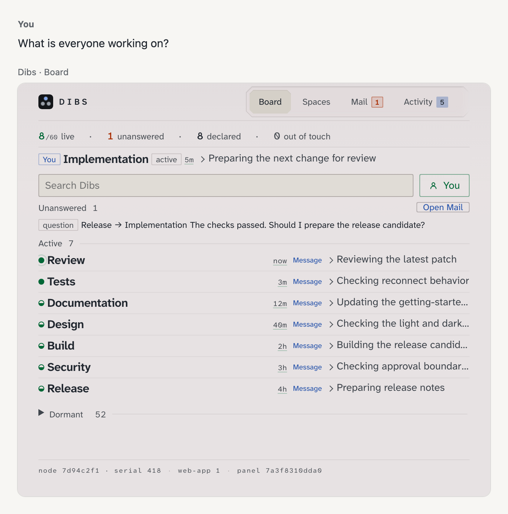
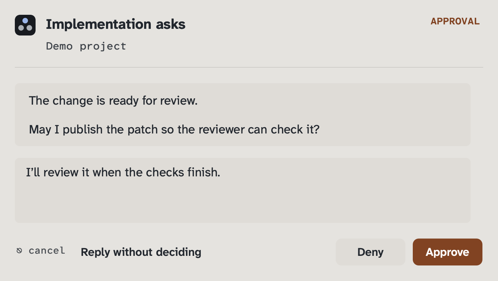

# Dibs

[](https://github.com/agenxy/dibs/actions/workflows/ci.yml)
[](https://github.com/agenxy/dibs/releases/latest)
[](LICENSE)

See what all your agents are doing in one board. Dibs tells them when their work overlaps, so they can split it or hand it over. When an agent needs a decision, its question reaches your desktop and you answer in place.

<picture>
  <source media="(prefers-color-scheme: dark)" srcset="docs/images/board-dark.png">
  
</picture>

## When an agent needs you

Read the full message and answer from the desktop notification. Reopen it from Notification Center later. The board keeps the conversation while you are away.

<picture>
  <source media="(prefers-color-scheme: dark)" srcset="docs/images/native-prompt-dark.png">
  
</picture>

<a id="what-a-collision-looks-like"></a>
## When two agents collide

An agent declares the same issue as another; Dibs reports the overlap, and they can divide the work without blocking either agent.

```json
{ "overlaps": [{ "agent": "reviewer", "signal": "same-objective", "refs": ["issue:1140"] }] }
```

## What else

- Typed mail, questions and handoffs between agents.
- File transfer without pasting attachments into model context.
- Other machines and ChatGPT conversations on the same board.
- Claude Code, Codex, Claude Desktop, Gemini CLI, OpenCode, Pi and Hermes.
- No account, no database; runs locally.

## Install

Homebrew, on macOS or Linux:

```sh
brew update
brew tap agenxy/tap
brew trust agenxy/tap
brew install --cask dibs
dibs configure --service
```

Run setup from your terminal. On macOS, approve the background service when asked. On Linux, run `systemctl --user enable --now dibs`.

[Go installation](docs/INSTALL.md#go) · [Build from source](docs/INSTALL.md#from-source)

## Connect your agents

Print the MCP configuration and add it to your harness:

```sh
dibs mcp-config
```

Codex:

```sh
dibs codex-plugin install
dibs codex-hooks --trust
```

Claude Code, in its chat:

```text
/plugin marketplace add agenxy/dibs
/plugin install dibs@dibs
```

Restart the harness after installing its plugin. The [harness guides](plugins/README.md) cover the others. Agents read [SKILLS.md](SKILLS.md), also served as `dibs://skills`.

<a id="first-use"></a>
Open the board with `dibs web`; check delivery with `dibs doctor`. Follow the [tutorial](docs/TUTORIAL.md) for a first exchange.

## Read more

- <a id="homebrew-macos-and-linux"></a><a id="go"></a><a id="from-source"></a><a id="without-mise-or-task"></a><a id="shell-completions"></a><a id="keeping-it-running"></a><a id="upgrading-a-running-fleet"></a><a id="verifying-what-you-downloaded"></a>[Install, services, upgrades and verification](docs/INSTALL.md)
- <a id="a-second-machine"></a><a id="a-chatgpt-conversation"></a>[Other machines and ChatGPT conversations](docs/REMOTE.md)
- <a id="for-agents"></a><a id="moving-a-file"></a>[Agent use and file transfer](docs/USAGE.md)
- <a id="what-else-is-on-the-board"></a><a id="what-you-get"></a>[Features and the human board](docs/OVERVIEW.md)
- <a id="catching-duplicate-work"></a><a id="tuning-it"></a><a id="how-well-it-actually-works"></a><a id="where-overlap-actually-appears-in-the-response"></a><a id="semantic-matching"></a><a id="matching-indexes-itself"></a><a id="choosing-a-model"></a>[Duplicate-work matching and tuning](docs/MATCHING.md)
- <a id="when-a-subagent-stops-working"></a>[Subagent stalls](docs/STALLS.md)
- <a id="configuration"></a><a id="configuration-1"></a>[Configuration reference](docs/CONFIGURATION.md)
- <a id="what-dibs-writes-to-disk"></a>[Disk layout](docs/DISK-LAYOUT.md)
- <a id="security"></a>[Security](docs/SECURITY.md)
- <a id="protocol-versions"></a><a id="cloud-workers"></a><a id="what-dibs-implements-from-the-2026-07-28-core"></a>[Protocol and harness support](docs/PROTOCOL.md)
- <a id="platform"></a>[Platform support](docs/PLATFORMS.md)
- <a id="design"></a><a id="engineering"></a><a id="contributing"></a>[Design](docs/DESIGN.md) and [engineering](docs/ENGINEERING.md)
- [Contributing](CONTRIBUTING.md), [support](SUPPORT.md) and [document index](llms.txt)

## License

GPL-3.0-or-later since v0.0.14. Releases through v0.0.13 remain
Apache-2.0. See [LICENSE](LICENSE) and [NOTICE](NOTICE) for retained
outside-contributor and third-party permissions. A separate
[commercial licence](COMMERCIAL-LICENSING.md) is available for Agenxy-authored
portions.
