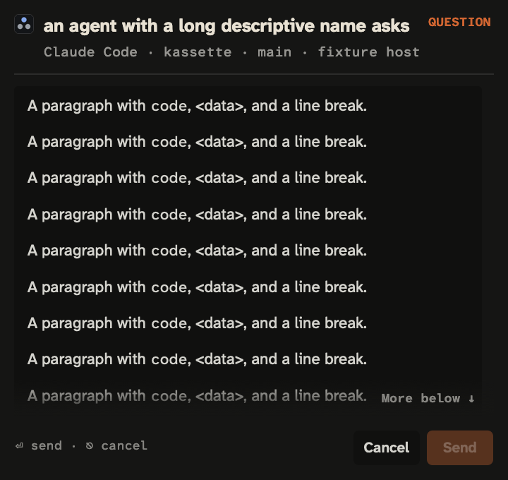

# Hosted macOS repair: 378921

The macOS failure at `2837caca` is retained as a failed run, not timing noise.
Linux, Windows and candidate success do not establish the macOS result.

## Muting selected the wrong protocol

With `DIBS_NOTIFY=off`, the new route was considered unavailable. The legacy
native route then ignored the switch. Running the real-entry test with that
environment reproduced the exact hosted failures locally: 14,014 bytes became
7,729, choices disappeared, and the synthetic legacy helper selected Approve
instead of delivering the typed-comment contract the test expected.
The local `2837caca` whole run reused a cached humanask result; the fresh hosted
runner executed this inherited environment. The repair was checked with an
uncached, explicitly silenced run rather than relying on that cached result.

The identity test reproduces `signal: killed` too. Its unchanged ten-second
parent context expires while a legacy waiter ignores the new reply event. A
context diagnostic records `context deadline exceeded`. Both private executable
copies already passed their side-effect-free setup launches. These observations
establish a timeout/protocol mismatch, not a rejected signature or overwritten
executable inode. Fixture copies now use exclusive creation in fresh directories;
only these private no-UI fixtures explicitly clear the notification kill switch.

The repair checks muting before native banners, asks, pickers or text-entry
execution. A silenced ask produces no post and no verdict, with the board route
in the error. A native startup failure or crash returns no answer and is never
retried through the legacy presenter. Only a negotiated, pre-post old-helper
capability miss retains the documented legacy action route.

Real `humanask.Ask` failure tests cover silence, invalid executable, crashes
before ready, after ready and after posting, and unnegotiated legacy replies.
They check no verdict, no hidden second launch, and exact full text in any post
that preceded a crash. Mixed text/button frames and typed replies on the legacy
protocol now fail closed. The silence case also enters passive/priority banners,
question, picker, text-prompt and native-reply APIs and checks no helper launch.

A mutation retrying native errors through the legacy presenter fails on an
after-post crash: 16,214 bytes become 3,296 in the second frame. This proves the
new failure guard detects that regression; it does not claim that this retry
existed at `2837caca`.

## Native selection stopped at the inner clip

A 600-point screen and 1× render reproduce the hosted end-glyph failure:
the inner text/clip are 11,242 points tall, the outer viewport is 337 points,
and it stays on page one (`endVisible=false`, bottom inset −10,893).
The text view considered the selection visible inside its full-height inner
clip, so it never moved the outer viewport. This is nested scrolling, not
a pixel-to-point rounding explanation.

The message text view now propagates native selection reveals through both
clips using view-coordinate conversion. The guard drives the native
end-of-document action and checks the last glyph and bottom space on four
screen sizes, including the small shared-scroll layout. It checks the PNG's
actual dimensions to prove 1× rendering was used. The local window's physical
backing scale remains 2; that is separate from the forced raster. Hosted macOS
remains necessary proof for the runner's actual display environment.

Removing only the outer-reveal propagation fails the native end-of-document
assertion at 1280×600 with the original −10,893 inset. The same test passes
with the repair under both native and forced-1× rendering. This is a separately
observed behavioral discriminator, unlike the earlier header-clipping control.

## Released request presenters

The source tags v0.0.6–v0.0.16 have separate request and question presenters.
Requests offer explicit Deny/Later/Approve actions and compare the returned
action with the literal `Approve`; they do not call the free-text prompt or
picker. The earlier helper's text-entry mode is separate from its request
button mode. No typed-request-comment field was found in those request paths.

Consequently the source audit finds no released request-comment-to-approval
conversion. The failed test's legacy helper deliberately returned the offered
Approve action; that fixture result alone does not demonstrate such a conversion
in a shipped release. This is a source audit of the pinned revisions below,
not a replay of historical users' notifications or a binary/fleet audit.
The native kill-switch bypass is a product defect and is included in the
Unreleased fix; no historical automatic-approval claim is made.

| Release | Pinned source | Request text-entry path | Approval condition |
|---|---|---|---|
| v0.0.6 | [request presenter](https://github.com/Agenxy/dibs/blob/dd2067103176b16f34ec9d82288b723192b7736b/internal/engine/human.go) | No | Exact `Approve` action |
| v0.0.7 | [request presenter](https://github.com/Agenxy/dibs/blob/974351e081c3a7198314c5abe0d5156b09e05f33/internal/engine/human.go) | No | Exact `Approve` action |
| v0.0.8 | [request presenter](https://github.com/Agenxy/dibs/blob/4fdffea38ddbc42dd75bcd4abe962514af6969d7/internal/engine/human.go) | No | Exact `Approve` action |
| v0.0.9 | [request presenter](https://github.com/Agenxy/dibs/blob/93ca2413c6f9db7ca5fe9ca9b37daa1d4843445f/internal/engine/human.go) | No | Exact `Approve` action |
| v0.0.10 | [request presenter](https://github.com/Agenxy/dibs/blob/b0a4f688d706f2bfb78a27b50b2100f923d8c1ef/internal/humanask/humanask.go) | No | Exact `Approve` action |
| v0.0.11 | [request presenter](https://github.com/Agenxy/dibs/blob/7110c01f23189614b15ca43a54cd5cd552534179/internal/humanask/humanask.go) | No | Exact `Approve` action |
| v0.0.12 | [request presenter](https://github.com/Agenxy/dibs/blob/e87d3268f44c826f4a967bf2fe3ab07ae043803f/internal/humanask/humanask.go) | No | Exact `Approve` action |
| v0.0.13 | [request presenter](https://github.com/Agenxy/dibs/blob/fc60cafc4de608498ed14dd7021f4ddb1e802964/internal/humanask/humanask.go) | No | Exact `Approve` action |
| v0.0.14 | [request presenter](https://github.com/Agenxy/dibs/blob/4a77e319e5bb224441c6d1bfecdda8875075de4b/internal/humanask/humanask.go) | No | Exact `Approve` action |
| v0.0.15 | [request presenter](https://github.com/Agenxy/dibs/blob/63c9a8408e3468402285f37c6422fa1984d7cd0e/internal/humanask/humanask.go) | No | Exact `Approve` action |
| v0.0.16 | [request presenter](https://github.com/Agenxy/dibs/blob/6dc4bb2ce6ce44fcf10a67231444edf97a81008c/internal/humanask/humanask.go) | No | Exact `Approve` action |
