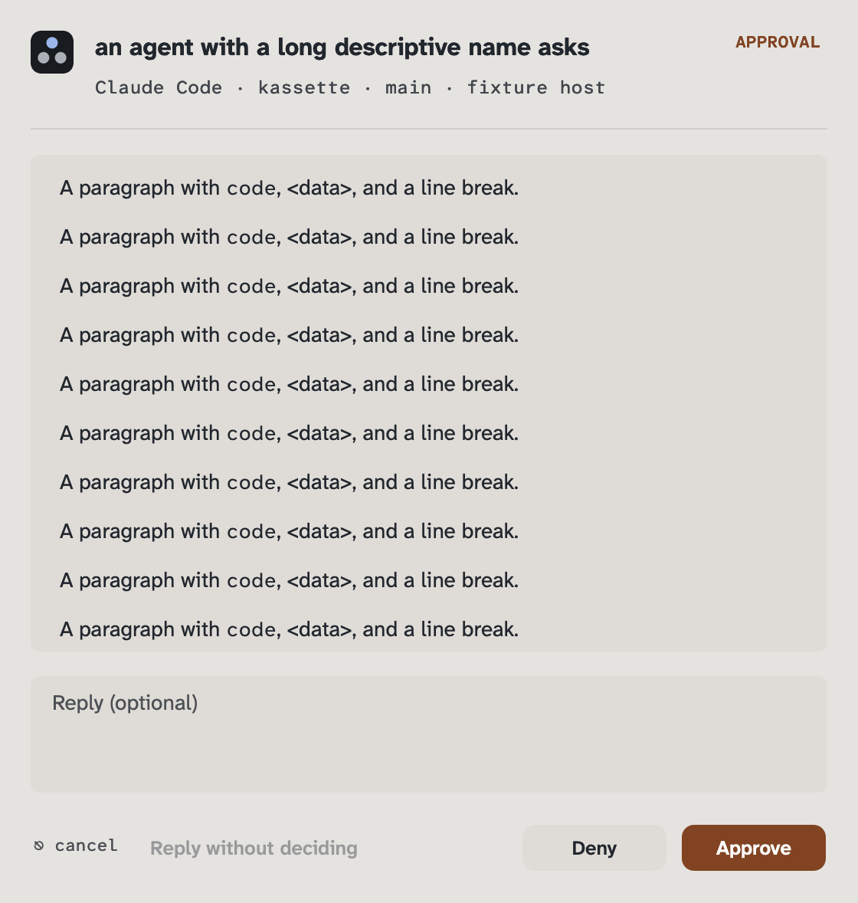
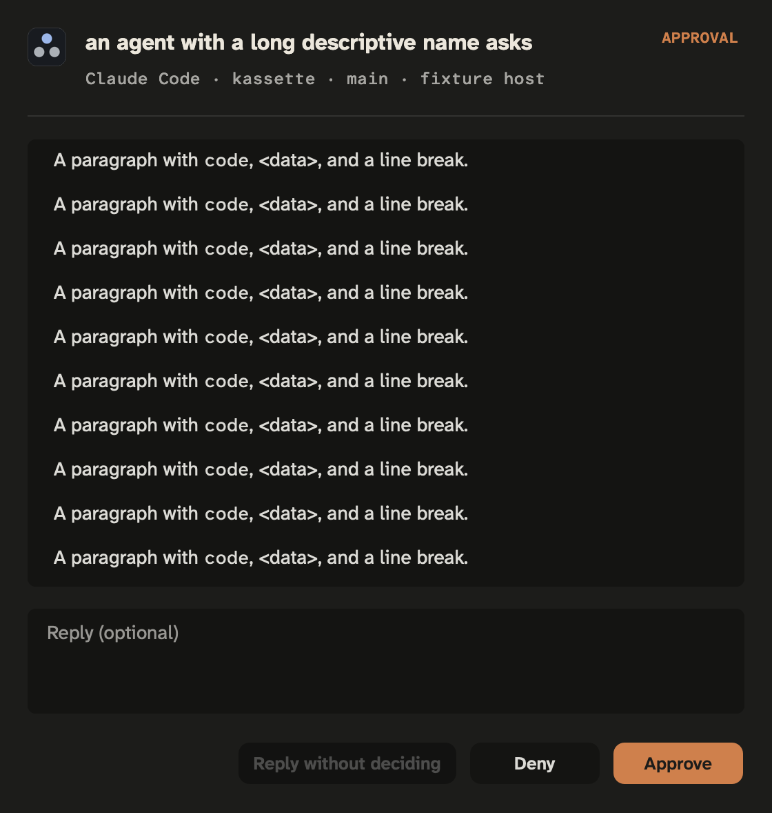
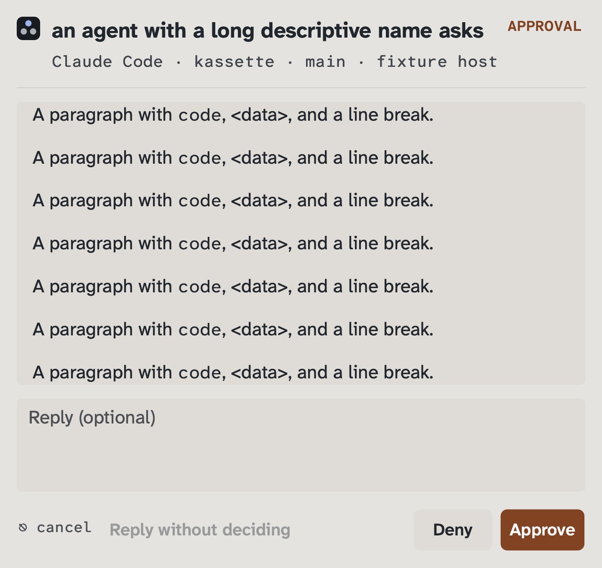
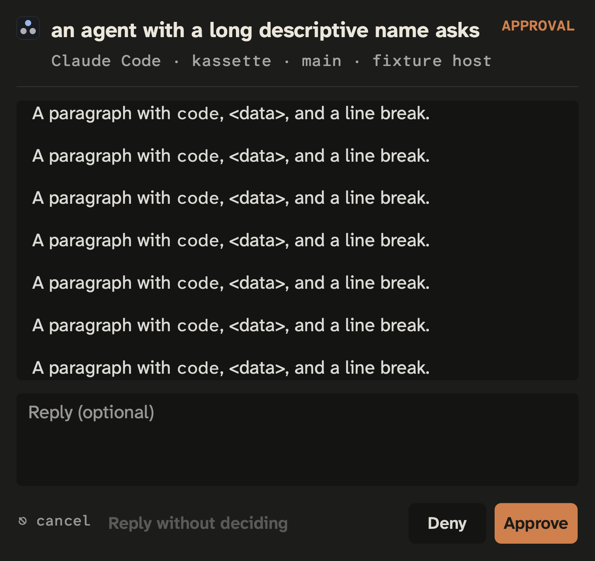
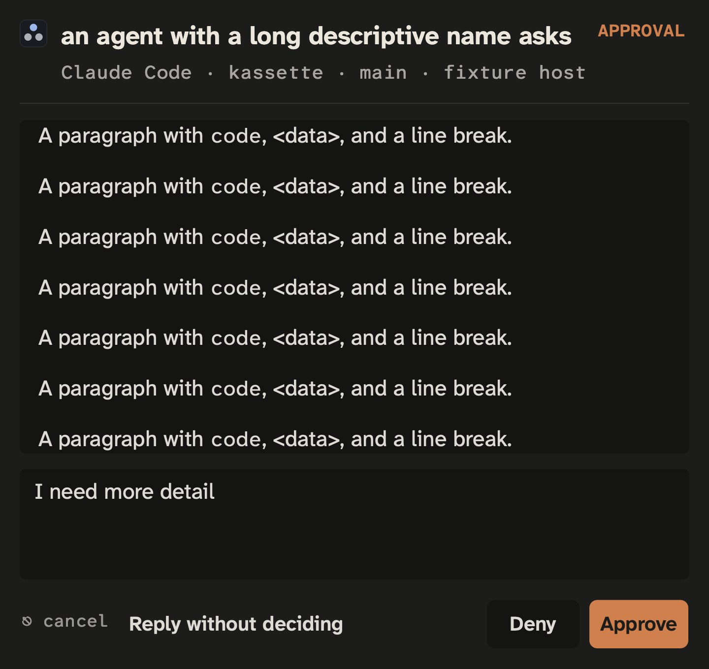

# Native prompt review: 378262

Synthetic mail only. These images are review evidence, not a production install
or a claim that a notification was visible to its recipient.

| Appearance | Before: hidden picker and abbreviated text | After: full text, visible choices and reply |
|---|---|---|
| Light, 100% |  |  |
| Dark, 100% |  |  |

| Large text | Light | Dark |
|---|---|---|
| 150% |  |  |
| 160%, 1280×800 screen |  |  |

At 160%, the message, choices and reply share the scroll region. The header and
footer remain pinned. “More below” signals content beyond the viewport. Tab
reveals the choices; editing reveals the reply field:


Requests retain explicit decision buttons, with no default approval:

| Text size | Light | Dark |
|---|---|---|
| 100% |  |  |
| 160% |  |  |

Typing enables the borderless no-decision reply, without making approval a
default. The footer keeps its Esc hint and separates this reply from decisions:



## How these were measured

The before images use the notifier source at `f16b91573657b842431332bfbeea61634ef4920b`
with a capture fixture and activation disabled. ScreenCaptureKit captured only
that private fixture's own window; no other app or real mail was captured. The
inactive light alert's window chrome can differ from an active modal alert.

The after images are AppKit content-view renders from
`TestNativePromptFullTextChoicesTypingAndNoImplicitApproval`. The test compiles
the shipped Swift source with a compile-time notification/user-gesture fixture;
it opens no live window, requests no authorisation and contacts no ChatGPT app.
It checks full raw and rendered message text, last-glyph visibility and bottom
space, wrapped choice labels, kind-label width, accessibility roles, native Tab
navigation, typed and choice-plus-note replies, and explicit request decisions.
The bundled fonts and canonical mark are used. All text sizes are captured
against a 1280×800 screen fixture, at the test machine's backing resolution.

The before presenter fails the new real-entry checks: long text is shortened,
the choices/note are lost, request comments become an approval path, and old
helper receipts do not report their missing reply field. Separate exact-old-file
controls fail for the new human-comment API and JSON-escaped 32 KiB answer.
Those controls are not a production desktop or fleet test.

The extra render check samples the pinned mark after scrolling. It passes with
the explicit viewport clipping. Removing that clipping did not reproduce the
observed overpaint in two bounded controls, so those controls are **not** claimed
as a demonstrated regression discriminator. The earlier before-code failures
above are independently observed.

The shared-scroll gutter check was observed failing before its background fix:
the light lane measured `[65535 65535 65535]` while adjacent paper measured
`[58853 58339 57311]`. After making both scroll and clip backgrounds transparent
and sizing the document to the actual viewport, the same check passes in both
appearances. This comparison uses neighbouring pixels in the same render,
preserving colour-profile differences rather than hard-coding RGB bytes.

The no-decision reply's disabled background was separately observed failing
against adjacent paper (`[38293 38036 37265]` versus `[58853 58339 57311]`).
Making it a text-only button passes the same pixel check in both appearances
and text sizes. Native layout checks also reject overlapping footer controls
or hints; the request keyboard checks still forbid an implicit verdict.

Regenerate after images with:

```console
DIBS_PROMPT_SCREENSHOTS=/tmp/dibs-prompt-review go test ./internal/notify -run '^TestNativePromptFullTextChoicesTypingAndNoImplicitApproval$' -count=1
```

The diagnostic probe measures the installed notifier image. A running broker
mapped from an older image is separately qualified by its pipe capability and
posting receipt; an installed-image probe alone does not prove it refreshed.

All native compilations now obtain the main file plus every `.inc` from
`internal/notify/app.ReadSource`: the production app builder, notify fixtures
and daemon settings fixture share that catalog. The latter was found by the
full local gate still compiling the main file alone; its original permission-free
settings test failed to compile, then passed after adopting the shared reader.
A bounded mutation that kept only the known prompt include fails the synthetic
future-include test, rather than silently omitting a new fragment. The actual
production bundle entry and its font-loading/status check pass with this reader.
